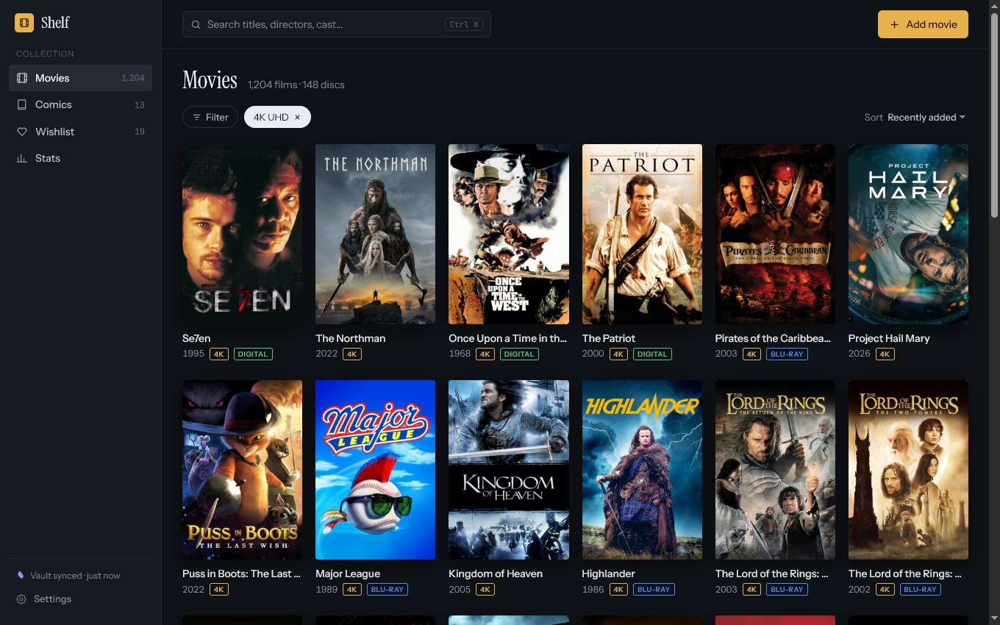
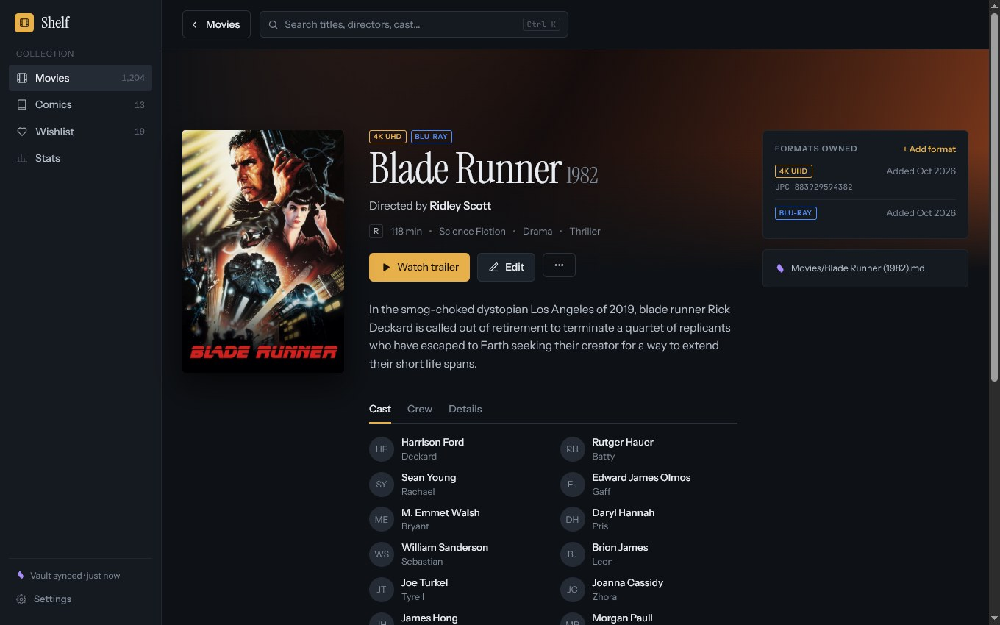
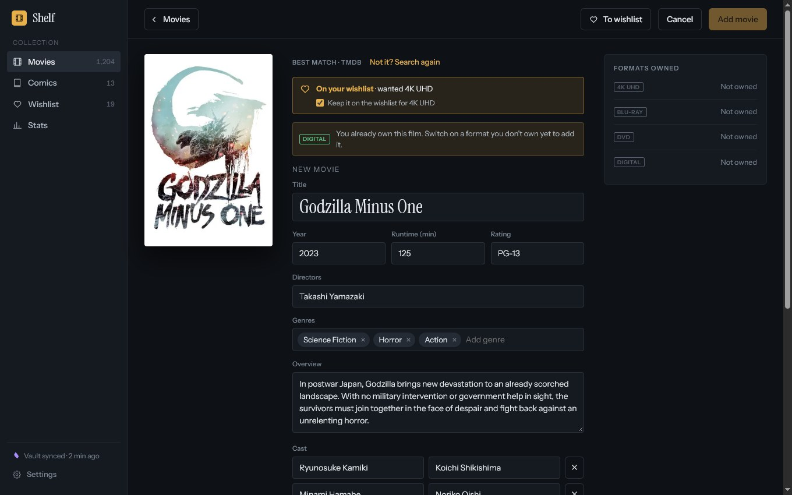
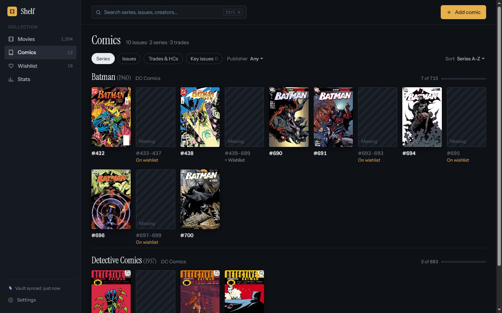
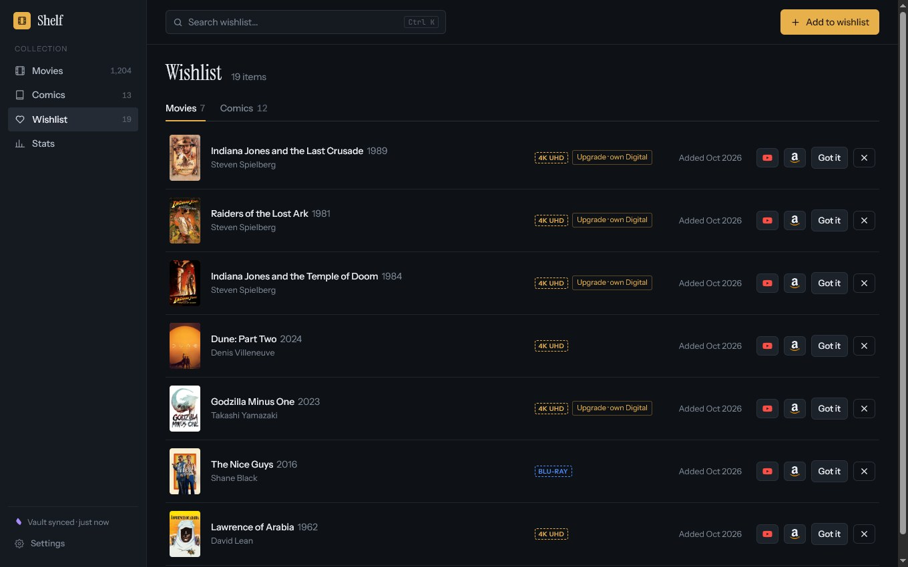
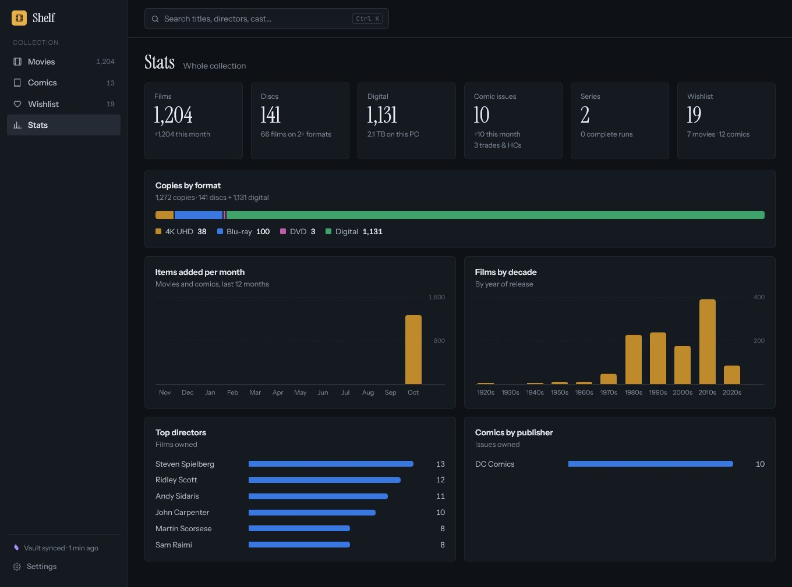
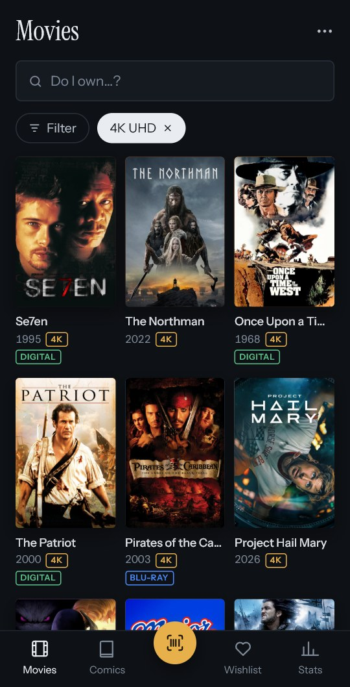
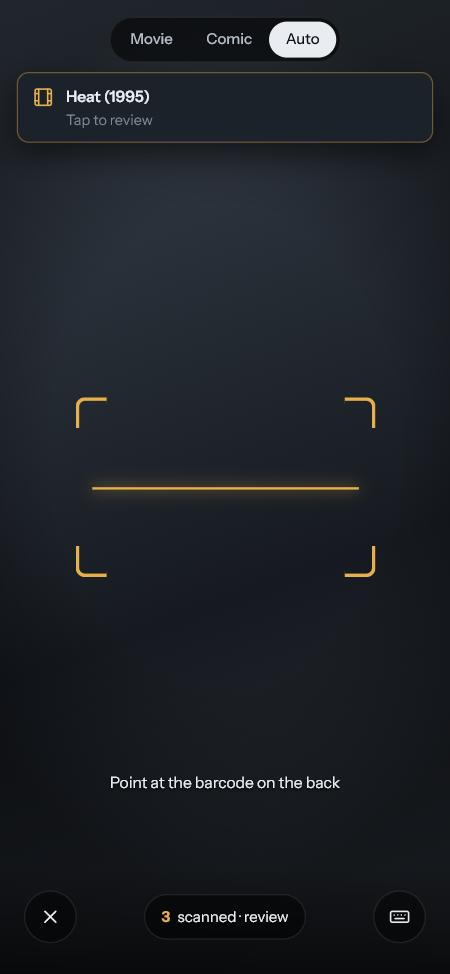
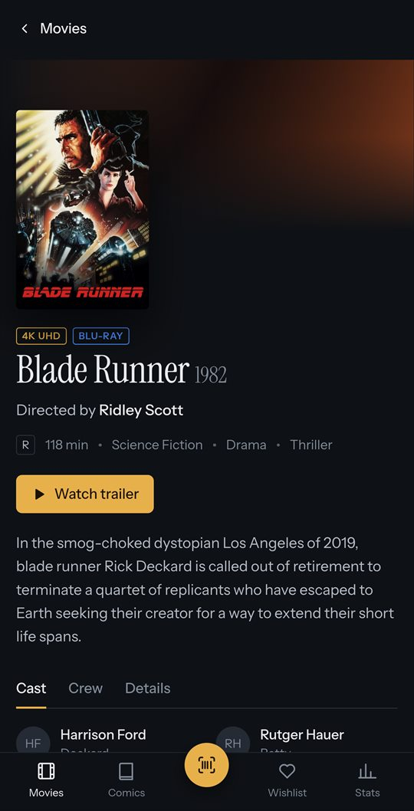
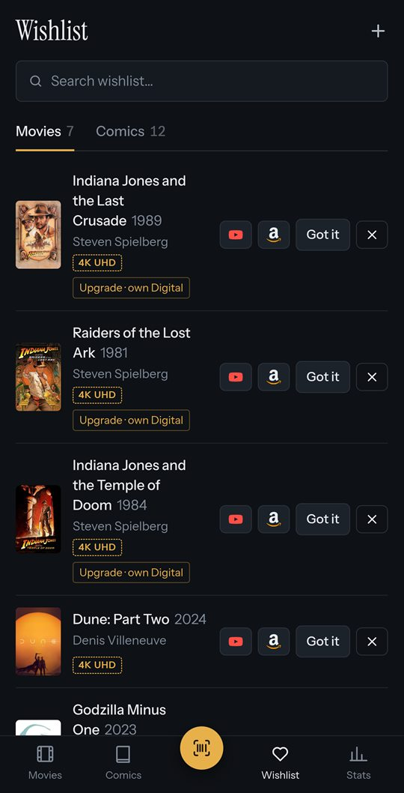

# Shelf

A collection tracker for **movies and comic books**: the discs and comics on your shelf, and the digital movies on your drive. A Windows app holds the collection; an Android app scans barcodes in the shop or at the shelf and syncs over your home Wi-Fi. Everything stays on your own devices: no account, no cloud.



## What it does

- **Movies and comics, kept apart.** Films on DVD, Blu-ray, 4K UHD and digital (one film, several formats); comics as single issues, trades, hardcovers and omnibuses.
- **Add by barcode or by name.** Details, cast, crew, covers and trailers come from online databases, and you can edit every field before anything is saved.
- **Scan with your phone.** Scan several barcodes in a row and review them one by one. Comic barcodes are read with their add-on digits, so the right issue is found.
- **Wishlist.** Scanning something you want tells you so on the spot. Each item has trailer and Amazon search buttons, and **Got it** moves it into the collection.
- **Missing issues.** Each comic series shows what you own out of the whole run, with the gaps as tiles you can send to the wishlist.
- **Digital movies.** Not everything is on a disc: point Shelf at a folder of video files; it matches them to films by name and plays them from the film's page.
- **Stats.** Counts by format, decade, director, actor and publisher, and what you added each month; a bar opens the matching list.
- **Works away from home.** The phone keeps its own copy of the collection, looks things up itself, and sends what it saved when the PC is next in reach.
- **Obsidian vault.** Shelf can mirror the collection into a vault as one Markdown note per film and comic, so you (or an AI assistant) can read and query it.

## Screenshots

### On the PC

| | |
|---|---|
|  A film's page: formats owned, cast, crew, trailer |  Reviewing a match before it is saved |
|  Comics by series, with the missing issues |  The wishlist |



### On the phone

<p>
  
  
  
  
</p>

## Getting started

There are no installers yet; you build Shelf from source.

### What you need

- Windows 10 (version 1809 or later) or Windows 11
- [.NET 10 SDK](https://dotnet.microsoft.com/download) and the MAUI workload: `dotnet workload install maui`
- For the phone app: an Android phone (Android 7.0 or later) with USB debugging switched on, and the Android SDK (installed with Visual Studio's MAUI workload or Android Studio)
- API keys for the online lookups (both free for personal use):
  - [TMDB](https://www.themoviedb.org/settings/api) for movies
  - [Metron](https://metron.cloud/) for comic issues

  Barcode lookups (UPCitemdb) and book lookups (Open Library) need no key. Without any keys you can still enter everything by hand.

### 1. Get the code

```bash
git clone https://github.com/brandonMccoy/MyMovieDatabase.git
```

### 2. Run the PC app

```bash
dotnet build src/MMDb.App/MMDb.App.csproj -f net10.0-windows10.0.19041.0
```

Then start `src\MMDb.App\bin\Debug\net10.0-windows10.0.19041.0\win-x64\MMDb.App.exe`, or open `MyMovieDatabase.slnx` in Visual Studio and run **MMDb.App** on Windows.

The first time it starts, Windows asks whether Shelf may accept connections; allow it on private networks so your phone can reach it. The collection is kept in `%LOCALAPPDATA%\Shelf` and backed up there each time the app starts.

### 3. Add your keys

Open **Settings → Online databases**, press **Add key** for TMDB (its API Read Access Token or the older API Key) and **Add token** for Metron, and paste each one in. Shelf checks a key with its service before keeping it, and again each time Settings opens. **Change** replaces or removes one, and a paired phone picks the change up the next time it syncs.

The keys are kept in `%LOCALAPPDATA%\Shelf\keys.dat`, encrypted by Windows for your account. They never go into the repository, the database or the phone app's package.

### 4. Install the phone app

Plug the phone in over USB, then:

```bash
dotnet build src/MMDb.App/MMDb.App.csproj -f net10.0-android -t:Install
```

### 5. Pair the phone with the PC

1. On the PC, open **Settings**. The **Phone** section shows a QR code and a six-digit code.
2. Open Shelf on the phone and scan the QR code, or type the PC's address and the code.

Both devices must be on the same Wi-Fi. Pairing is done once; after it the phone copies the collection and receives your API keys from the PC, which it keeps in Android's keystore.

## Using Shelf

### Adding movies and comics

- **On the PC:** press **Add movie** or **Add comic** and type a title (add the year to narrow it down), a series and issue number, or a UPC. The screen opens with the cursor in the search box, so you can type straight away, or scan with a USB barcode scanner. Pick the right match, change anything you like, and save.
- **On the phone:** tap the round scan button and point the camera at the barcode on the back. Keep scanning; each item waits in a queue until you review it. **Auto** tells films, comic issues and books apart by their barcodes; switch to **Movie** or **Comic** if it guesses wrong. When you open an Add screen to type a name instead, the keyboard comes up by itself.
- A film you already own on another format is added as a new format of the same film. The same copy of a comic is turned down as a duplicate; a different cover or printing counts as its own copy.

### Wishlist

Use **To wishlist** on the review screen, **Add to wishlist**, or **+ Wishlist** on a run of missing comic issues. When you look up or scan something that is on the list, Shelf says so. The red button opens the trailer, the Amazon button searches Amazon for the title, and **Got it** opens the review screen to add it to your collection.

### Digital movies (PC only)

In **Settings → Digital movies**, choose the folder that holds your video files. Shelf matches the files to films by their names and lists them for review; nothing is added until you confirm. New files dropped into the folder show up for review, and a film with a file gets a **Play file** button.

### Obsidian vault

In **Settings → Obsidian vault**, turn on **Use a vault** and choose a folder. Shelf writes one note per film, comic and wishlist item, an index, and ready-made Bases views, and keeps them up to date as you make changes. Each note carries its details as properties:

```yaml
title: Blade Runner
year: 1982
formats:
  - 4K UHD
  - Blu-ray
directors:
  - Ridley Scott
genres:
  - Science Fiction
  - Drama
  - Thriller
runtime: 118
rating: R
```

The mirror is one-way: Shelf never reads the notes back, except that anything you write under a note's **My notes** heading is kept when the note is rewritten.

### Away from home

The phone works from its own copy, so you can check what you own, look things up and add items anywhere. What it saved is sent to the PC the next time both are on the same network, or when you choose **Sync now**. Editing and deleting items the PC already has is done on the PC.

## What's planned

### Digital comics

Not built yet, and it may change. The idea is the comic counterpart of digital movies: point Shelf at a drive of comic files, and read them in a comic reader built into Shelf.

## For developers

Shelf is C# on .NET 10: a .NET MAUI Blazor Hybrid app for Windows and Android, with SQLite on both devices and an HTTPS API on the PC that the phone talks to over the LAN.

- [docs/ARCHITECTURE.md](docs/ARCHITECTURE.md): how it is put together and why
- [docs/TESTING.md](docs/TESTING.md): how it is tested
- [docs/design/DECISIONS.md](docs/design/DECISIONS.md): the design decisions

Run the checks (restore, build with warnings as errors, tests):

```powershell
./scripts/test.ps1
```

Add `-SkipApp` to leave out the slow MAUI app build while iterating.

## Credits

Film data and images come from [TMDB](https://www.themoviedb.org/). This product uses the TMDB API but is not endorsed or certified by TMDB. Comic data comes from [Metron](https://metron.cloud/), book data from [Open Library](https://openlibrary.org/), and barcode lookups from [UPCitemdb](https://www.upcitemdb.com/).
